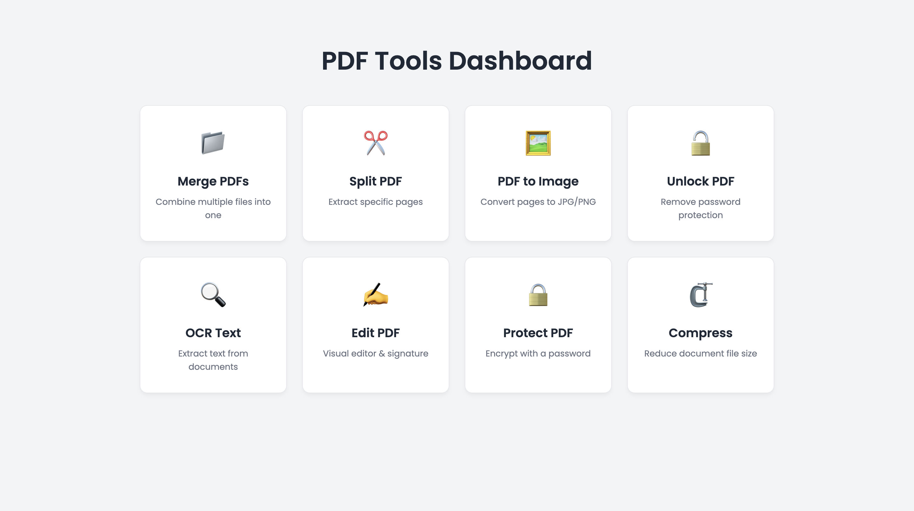

# PDFTools

I made PDFTools to do common PDF tasks in one website, without installing an app.

## Screenshot

## Features

- **Merge PDF** — Join multiple PDF files.
- **Split PDF** — Extract a page from a PDF.
- **PDF to Image** — Convert a PDF page to JPG.
- **Unlock PDF** — Save a copy using the correct password.
- **OCR Text** — Read text from an image.
- **Edit PDF** — Add text to a PDF.
- **Protect PDF** — Protect a PDF with a password.
- **Compress PDF** — Try to reduce the file size.

## Made with

HTML, CSS and JavaScript, with pdf-lib, PDF.js and Tesseract.js.

## How it works

The files are processed in the browser instead of being uploaded to my server.

## Run it

Open `index.html` in your browser. If something doesn't work, try running it with a local server.
